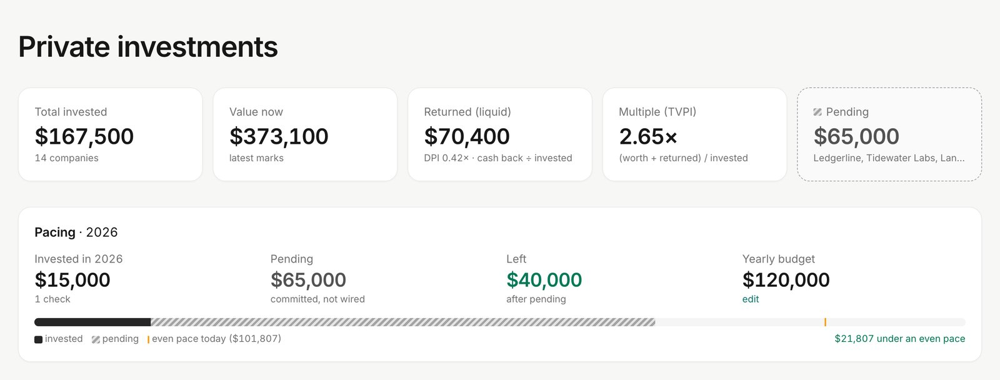
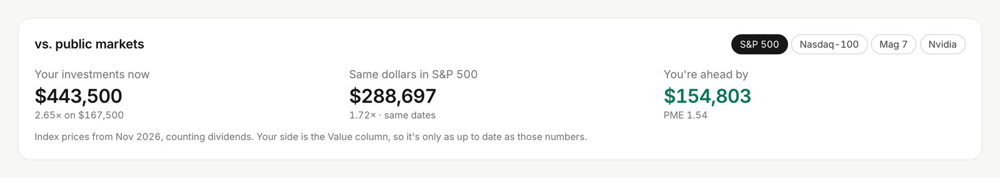
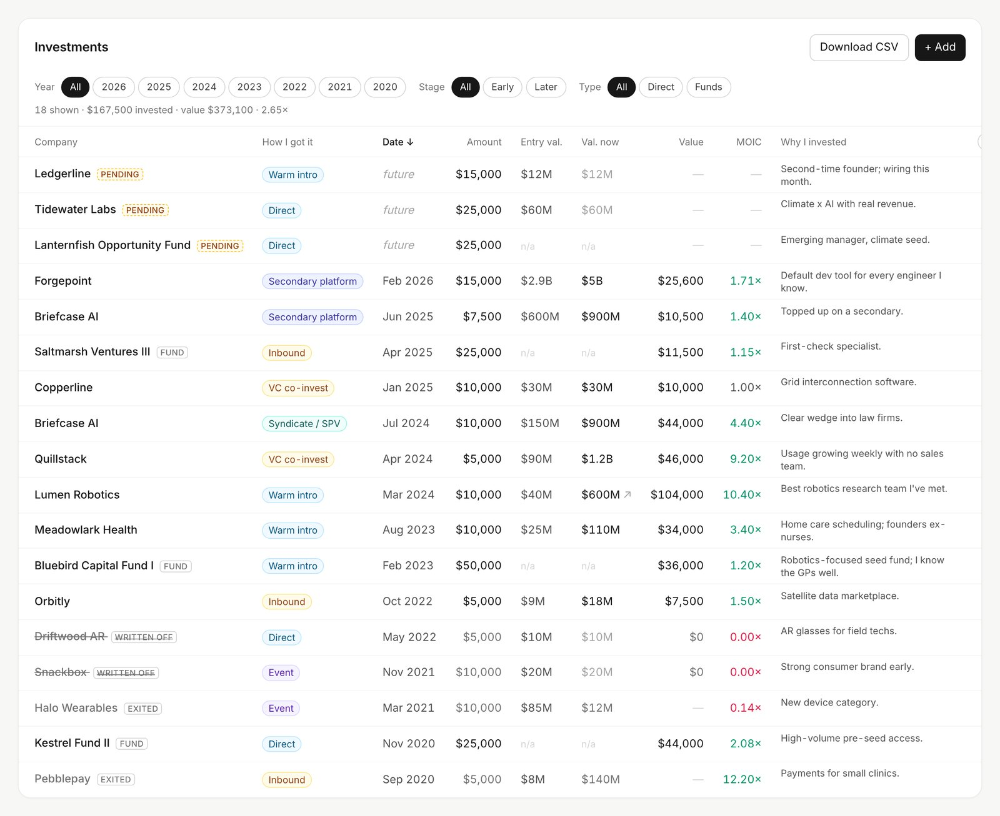
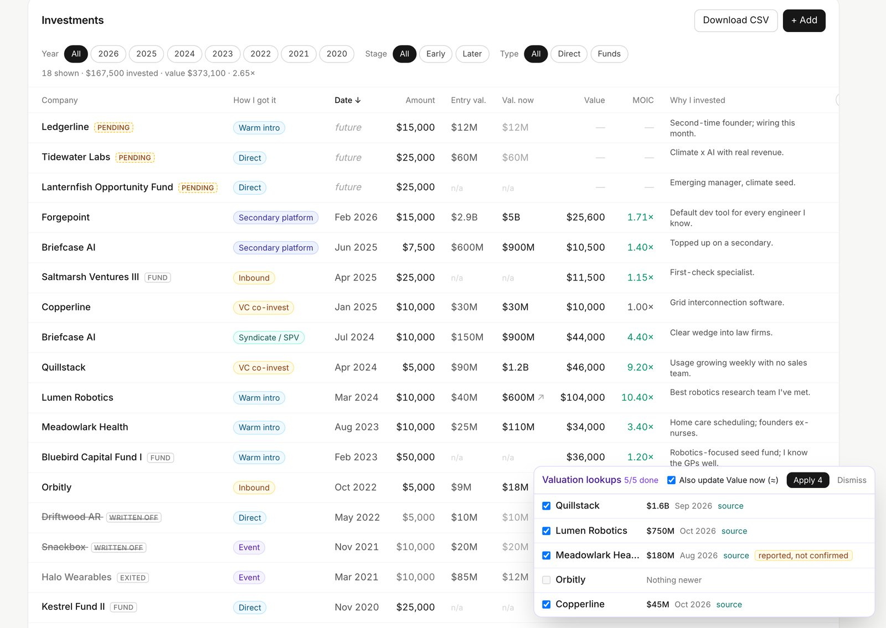
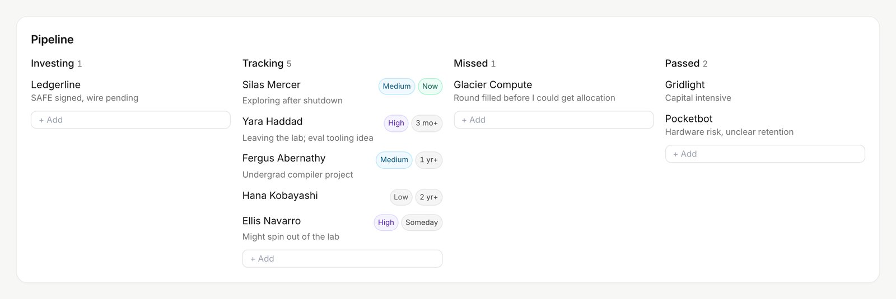

# Private investments

A local Flask app for tracking private investments: direct and fund (LP) positions, yearly
pacing against a budget, a public-market benchmark, live deals being evaluated, a pipeline of
people and companies to watch, and who to forward deals to.

- **Investments**: entry/current valuation and stage, value now, cash returned, MOIC,
  TVPI/DPI, funds with committed vs. called capital, filters by year/stage/type, CSV export.
- **Valuation lookup**: proposes a fresh valuation/stage for a holding from a web search
  (Claude API). Nothing is saved until you accept it.
- **vs. public markets**: what the same dollars on the same dates would be worth in the
  S&P 500, Nasdaq-100, the Magnificent 7 or Nvidia (weekly prices from Yahoo Finance).
- **Evaluating / Pipeline / Forward deals to**: lightweight lists; committing an evaluated
  deal turns it into a pending investment.

All data lives in a local SQLite file (`portfolio.db`), which is gitignored along with
backups, the price cache, CSV exports and `.env`. The server also writes one backup a day to
`backups/` (last 30 kept).

## Screenshots

From the fake demo dataset (see [Demo with fake data](#demo-with-fake-data)).

Totals and yearly pacing against a budget:


The same dollars, on the same dates, in a public index:


Investments table:


Valuation lookups: proposed marks with sources, applied only once accepted:


Pipeline of people and companies to watch:


## Setup

```sh
python3 -m venv venv
./venv/bin/pip install -r requirements.txt
echo "ANTHROPIC_API_KEY=sk-ant-..." > .env   # optional: valuation lookup
./run.sh                                      # http://127.0.0.1:5557
```

### Coming from the combined CRM

This used to live inside a personal CRM and shared its `crm.db`. To copy the portfolio tables
(investments, pipeline, evaluating, forward_to, portfolio_settings) out of that file:

```sh
./venv/bin/python migrate_from_crm.py ../crm/crm.db   # writes portfolio.db; source is opened read-only
```

It refuses to overwrite an existing `portfolio.db` unless you pass `--force`, and checks that
every copied table matches the source.

## Demo with fake data

`seed_demo.py` builds a made-up dataset (18 investments incl. funds, exits and write-offs,
pipeline, evaluating, forward-to list) in `demo.db`. Every company, fund and person is fictional.

```sh
./venv/bin/python seed_demo.py                              # writes demo.db
PORTFOLIO_DEMO=1 PORT=5558 ./venv/bin/python app.py         # http://127.0.0.1:5558
```

With `PORTFOLIO_DEMO=1` the app reads only `demo.db`, never opens `portfolio.db`, and skips
backups. The page also has a client-side sample mode at `/?demo=1` that never calls the server.

## Environment

| Variable | Default | |
|---|---|---|
| `PORTFOLIO_DB` | `portfolio.db` (`demo.db` in demo mode) | SQLite path |
| `PORTFOLIO_DEMO` | unset | `1` = demo mode (see above) |
| `PORT` | `5557` | |
| `ANTHROPIC_API_KEY` | unset | valuation lookup |
